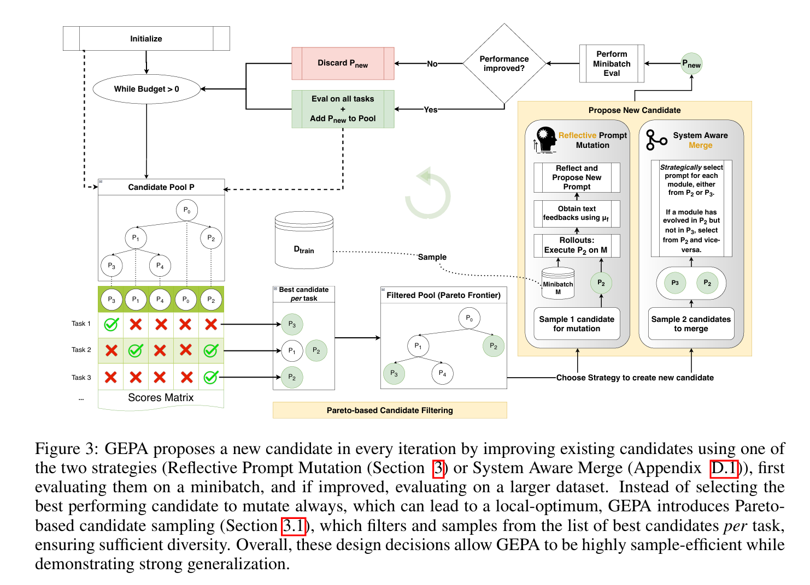
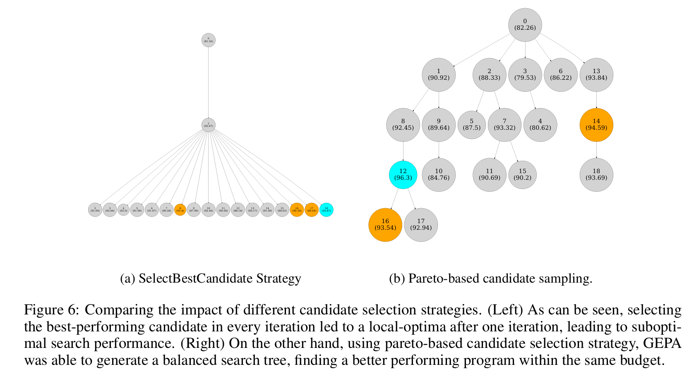
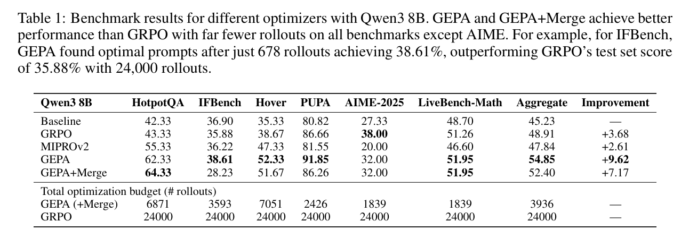
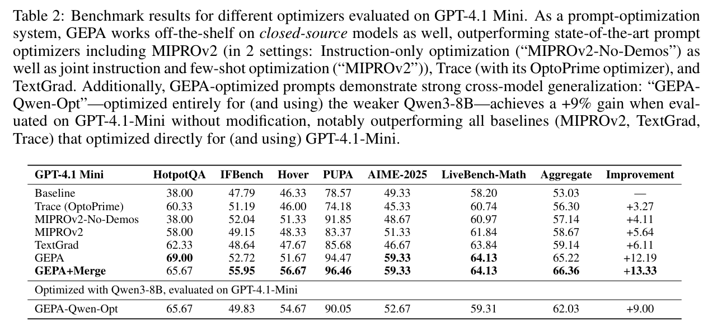
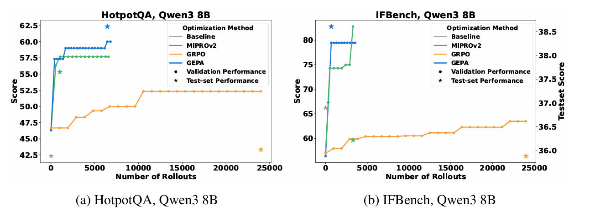
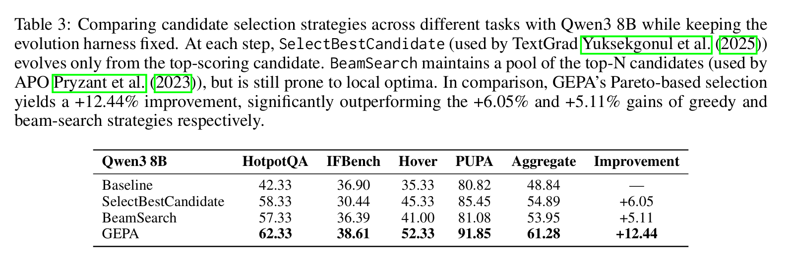
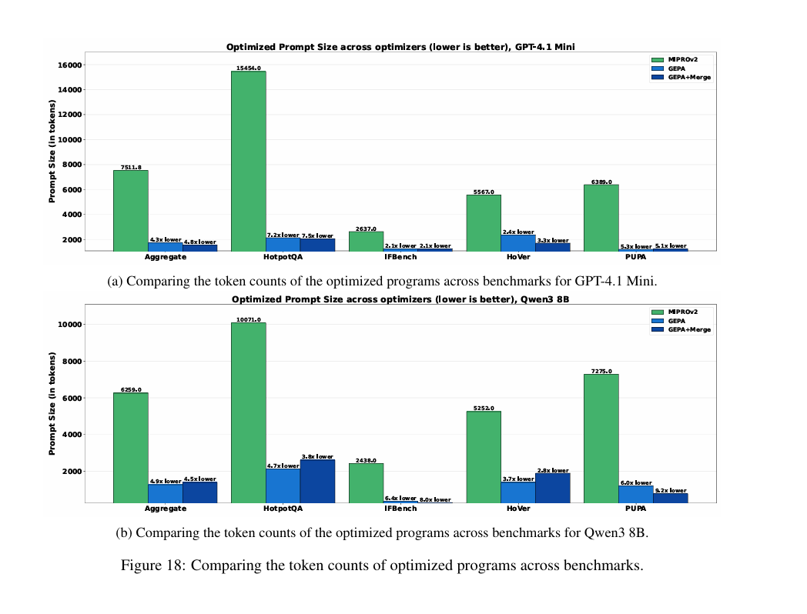

# GEPA （ICLR 2026 Oral）

参考文章：[ GEPA：反思式Prompt进化，效果超过RL - 知乎](https://zhuanlan.zhihu.com/p/1942188940221216523)

## ABSTRACT

与稀疏，标量的奖励（sparse, scalar rewards）推导出的策略梯度相比，自然语言本身具有可解释性，能够为 LLM 提供更加丰富的学习媒介。

 **GEPA（Genetic-Pareto）**，**一种 Prompt 优化器（Prompt Optimizer）**。它充分利用自然语言反思（natural language reflection），通过试错学习高层次的规则。

**强化学习虽然能优化 Agent 或者 LLM 表现，但往往需要大量 Rollout；而每次 Rollout 实际上包含了丰富的自然语言信息，这些信息没有被充分利用。GEPA 想做的，就是让 LLM 直接从执行轨迹中反思、总结经验，并据此优化 Prompt。**

GEPA 都会采样系统执行轨迹（trajectories），例如推理过程、工具调用以及工具输出，并使用自然语言对这些轨迹进行反思，从而：

- 诊断执行过程中出现的问题；
- 提出并测试 Prompt 更新方案；
- 从自身尝试形成的 Pareto 前沿（Pareto frontier）中，组合互补的经验与教训。

GEPA，是一种反思式的**Prompt Optimizer**，将**文本反思（textual reflection）**与**多目标进化搜索（multi-objective evolutionary search）**结合起来。

## **PROBLEM STATEMENT**

定义GEPA所要解决的问题。给定一个复合型AI系统 $\Phi$，其可学习的参数是 prompt集合$\Pi$ 和权重集合$\Theta$。优化的目标是找到最优参数 $(\Pi^*, \Theta^*)$，使得系统在任务分布 $\mathcal{T}$上的期望 $\mu$ 最大化：
$$
(\Pi^*, \Theta^*)_\Phi = \arg\max_{(\Pi, \Theta)} \mathbb{E}_{(x,m) \sim \mathcal{T}} [\mu(\Phi(x; (\Pi, \Theta)), m)]
$$
其中，$(x,m)$ 是一个任务实例，$\mu$ 是评估指标（如精确匹配率、F1等）。

而GEPA关注的是**样本高效的优化（Sample-Efficient Optimization）**问题，即Rollout 不超过预算 $B$ 内，找到最优的prompts $\Pi^*$（权重 $\Theta$ 固定）：
$$
(\Pi^*, \Theta^*)_\Phi = \arg\max_{(\Pi, \Theta)} \mathbb{E}_{(x,m) \sim \mathcal{T}} [\mu(\Phi(x; (\Pi, \Theta)), m)] \quad \text{s.t.} \quad \#\text{rollouts} \le B
$$

## **GEPA: Reflective Prompt evolution**

 GEPA设计基于三个核心原则：

- **遗传式 Prompt 演化（Genetic Prompt Evolution）** 对应 **Genetic Optimization Loop（遗传式优化循环）**
- **利用自然语言反馈进行反思（Reflection Using Natural Language Feedback）** 对应 **Evaluation Traces as Diagnostic Signals（将评估轨迹作为诊断信号）**和 **Reflective Prompt Mutation（反思式 Prompt 变异）**
- **基于 Pareto 的候选选择（Pareto-based Candidate Selection）**对应 **PARETO-BASED CANDIDATE SELECTION（ 基于帕累托的候选项选择）**

### **Genetic Optimization Loop（遗传式优化循环）**

GEPA的整体框架借鉴了演化算法的思想。它将每个完整的提示配置（即系统中所有模块的提示集合）看作一个“候选者”。优化过程就是一个种群（候选池 ）不断演化的过程。

GEPA的工作流程可以概括为：

1. **初始化**：从一个或多个基础的提示方案开始，构成一个“候选池”  $P$。
2. **迭代循环**：在部署预算用尽之前，不断重复以下步骤： 
   1. **选择**：从候选池中，通过帕累托选择（Pareto selection）挑选出一个有潜力的候选者进行**变异**，或者选择两个候选者去**交叉**。 
   2. **变异（Mutation）**：对选定的候选者进行修改，生成一个新的候选者。修改的方式是“Reflective Prompt Mutation”。 
   3. **交叉（Crossover）**：对应着**系统感知合并（System Aware Merge）**，即从两个优秀的父代中挑选出各自最好的模块，组合成一个更强的后代。
   4. **评估**：在抽样的小批次 （Minibatch） 上快速评估新候选者的性能。 
   5. **更新**：如果性能相较其“父代”有所提升，则将它连同祖先记录（Ancestry Records）一起加入候选池 \(P\)，并在$D_{\text{pareto}}$上进行评估。\(D_{\text{pareto}}\) 是用于候选选择的验证集。
3. **返回最优**：预算耗尽后，返回在 \(D_{\text{pareto}}\) 上具有最佳整体表现的候选项。

感觉叫遗传有点是为了跟自然界的遗传沾边呀，有点故事会的意思呀，不过这个遗传的思路还是挺像的。

### **Evaluation Traces as Diagnostic Signals（将评估轨迹作为诊断信号）**

LLM 生成的文本是 AI 系统的**执行轨迹（Execution Trace）**。除了对执行轨迹进行反思之外，**评估轨迹（Evaluation Trace）**是另一种有价值的诊断信息来源。

许多评价指标会采用较为复杂的评估流程。例如，代码评估可能涉及编译、执行和性能分析（Profiling）。在最终计算出标量奖励之前，这些过程会产生自然语言形式的轨迹。我们提出利用这些评估轨迹来进行反思式信用分配（Reflective Credit Assignment）和有针对性的 Prompt 更新。（GEPA里面的信用分配感觉可以理解成：判断系统的成功或失败应归因于哪些具体的prompt）

GEPA 通过将奖励函数 \(\mu\) 扩展为反馈函数 \(\mu_f\) 来实现这一点。反馈函数会在评估过程中提取文本轨迹，最终 \(\mu_f\)不仅返回一个分数，还返回一个 `feedback_text` 字符串。

### **Reflective Prompt Mutation（反思式 Prompt 变异）**

轨迹记录了中间推断过程和底层推理步骤，**轨迹**与系统的**最终结果**（例如成功或失败）结合起来时，它们便具有很强的诊断价值。LLM 可以通过反思（Reflection）利用这些轨迹，执行隐式的信用分配（Implicit Credit Assignment），将最终结果的责任归因于相关模块。（这里的思路是有一个**反思大模型**去做隐式的信用分配，具体而言就是修改单个模块的 prompt）

GEPA 根据一种策略选择需要更新的模块。在本文中，模块选择采用轮询策略（Round-robin Policy），即在语言程序包含的 \(|M|\) 个模块中轮流选择。

在当前优化循环的某次迭代中，GEPA 会选取一个待 Mutation 的候选项。接着，GEPA 在训练集上随机采样一个输入查询小批次（对应图片3中的 Minibatch），并执行所选候选项，同时追踪程序的执行过程。GEPA 提取当前模块的输入、输出和推理过程，并调用反馈函数 \(\mu_f\)。该函数会返回一个数值分数，以及文本反馈（Text Feedback），其中包括评估过程的详细信息，例如编译器错误信息、未通过的评估标准（Failed Rubrics）等。

随后，反思大语言模型会接收到以下内容：

- 当前模块的 Prompt（Current Prompt）
- 语言程序的执行轨迹（Language Program Trajectory）
- 分数（Score）
- 文本反馈（Text Feedback）

它的任务是通过反思，将成功或失败归因于 Prompt 中的相关元素，并提出修改后的指令。更新后的模块会与语言程序中的其他部分一起，再次在**该小批次**上接受评估。如果分数有所提升，那么新的程序就会被加入候选池。

其中反思大模型一般是高级模型，元提示（Meta-Prompt）结构大致如下（详见论文附录图B）：
  **我给一个助手提供了以下指令来执行一个任务：**
 <当前模块的指令>
 **以下是该助手在不同输入下的表现，以及关于其表现可以如何改进的一些反馈：**
 <这一批 minibatch 样本的输入、输出、分数和文本反馈>
 **你的任务是为这个助手写一个新的、改进后的指令。**

### **PARETO-BASED CANDIDATE SELECTION（ 基于帕累托的候选项选择）**

朴素的方法是始终选择当前表现最好的候选项。但这种方式经常会使优化器陷入局部最优（Local Optimum）：一旦找到一个占主导地位的策略，就很难超越它，最终优化器会耗尽预算，却没有学到其他可能更好的新策略。

GEPA 采用了一种基于 Pareto 策略。对于每一个训练实例，GEPA 都会记录所有候选项在该实例上取得的最高分数，从而形成一个 Pareto Frontier。

个人理解：帕累托选择里面的 $D_{\text{pareto}}$ 的任务组，是随机划分的，原文没有讲解。$D_{\text{pareto}}$ 相当于验证集，而 $D_{\text{feedback}}$ 是训练集（根据Algorithm 1，原来的 $D_{\text{train}}$被分割成 $D_{\text{feedback}}$ 和  $D_{\text{pareto}}$ ）。

对于每一个验证任务组，GEPA 都会记录所有候选项在该组上取得的最高分数，从而形成一个 Pareto Frontier。首先在至少一个任务组上取得最高分数的候选项会被保留下来。然后对于那些严格被其他候选项支配的候选项则会被剪枝。

figure 6 里面的分数，应该是 $D_{\text{pareto}}$里面的平均值

##  EVALUATION

作者在六个 Benchmark 上进行评估：

- **AIME-2025**：数学竞赛问题。
- **LiveBench-Math**：数学推理任务。
- **HotpotQA**：多跳问答任务。
- **IFBench**：指令遵循任务。
- **HoVer**：事实验证任务。
- **PUPA**：隐私保护委托任务。

### **Qwen3 8B 上的实验结果：**

### **GPT-4.1 Mini 上的实验结果：**

Optimized with Qwen3-8B,evaluated on GPT-4.1-Mini 指一个跨模型迁移实验：先在 Qwen3-8B 上把 prompt 优化好，再一个字不改，直接拿到 GPT-4.1 Mini 上测试。这一行就叫 GEPA-Qwen-Opt。

### **Observation 1：反思式 Prompt 演化具有很高的样本效率，并且能够超过权重空间中的强化学习**

与使用 24,000 次 Rollouts 的 GRPO 相比：

- GEPA 的性能最高可提升 19%。
- 同时最多只需要 GRPO 1/35 的 Rollouts。
- 在达到最优测试性能时，GEPA 使用的 Rollouts 数量减少了 4–35 倍。
- 在六项任务中的五项上，GEPA 超过了 GRPO，提升幅度分别为 19.0%、2.73%、13.66%、5.19% 和 0.7%。

GEPA 仅使用 243、402、330、1143、1179 和 306 次 Rollouts，就达到了 GRPO 的最佳验证集表现，样本效率最高提升了 78 倍。

GEPA+Merge 进一步扩大了这一差距：在与 GEPA 相近的 Rollout 预算下，其表现比 GRPO 高出 21%。

作者还指出，GEPA 的 Rollout 预算中，大部分实际上花在了验证（$D_{\text{pareto}}$上面的验证）上。在验证过程中，分数仅用于候选项选择，并不会产生学习信号。

### **Observation 2：仅优化 Instruction 的反思式 Prompt 演化，可以超过联合优化 Instruction 和 Few-shot Examples 的方法**

此前的研究，例如 Opsahl-Ong et al. (2024) 和 Wan et al. (2024)，已经有力地证明了 Few-shot Example 优化的有效性。在许多情况下，Few-shot 优化甚至超过了基于 Instruction 的方法。

但作者的发现表明，这一趋势可能正在发生变化。作者认为，这主要归因于两个因素：

1. LLM 的 Instruction Following 能力和自我反思能力近年来取得了进步。
2. GEPA 的设计能够充分利用这些能力。

### **Observation 3：下一候选项的选择策略会显著影响优化轨迹和最终性能，Pareto-based Sampling 具有明显优势**

作者固定 Prompt Evolution 的其他部分，只改变 Candidate Selection 策略，比较了三种方法：

1. **SelectBestCandidate**：每次只从当前得分最高的候选项继续演化。TextGrad 使用了类似策略。
2. **BeamSearch**：维护一个得分最高的 Top-N 候选池。APO 使用了类似策略。
3. **GEPA Pareto-based Selection**：根据 Pareto Frontier 进行候选项选择。

### **Observation 4：Instruction 优化得到的 Prompt，比 Few-shot Demonstration Prompt 计算成本更低，泛化能力更好**

除了具备较强的泛化能力之外，反思式演化得到的 Instruction 还有一个重要的实际优势：**它们通常更短，因此计算效率更高。**而对于复杂任务，这一优势尤其明显，因为即使一个 Few-shot Demonstration，也可能非常长。值得注意的是，GEPA 和 GEPA+Merge 生成的 Prompt 最多比 MIPROv2 短 9.2 倍。这不仅提高了模型性能，也显著改善了计算效率。此外，作者观察到一个趋势：整体而言，性能更高的优化器往往会生成更短的 Prompt（见图 17）。

